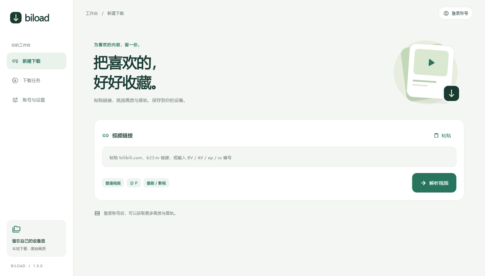
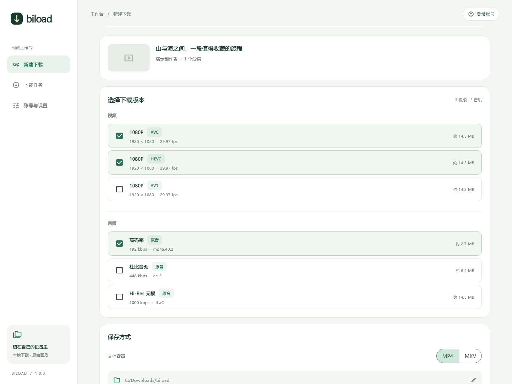
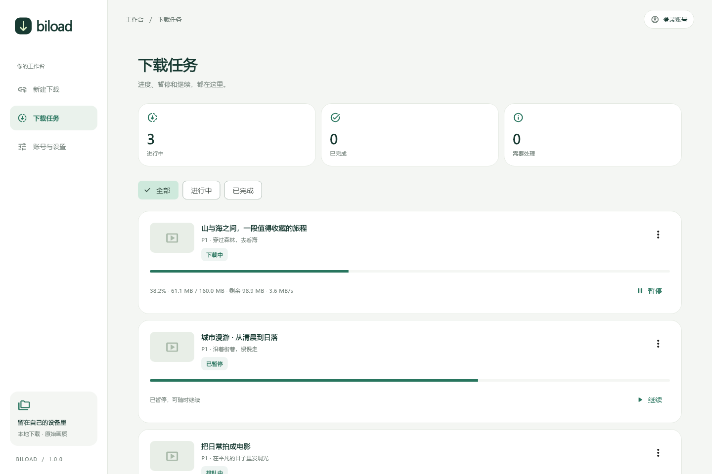
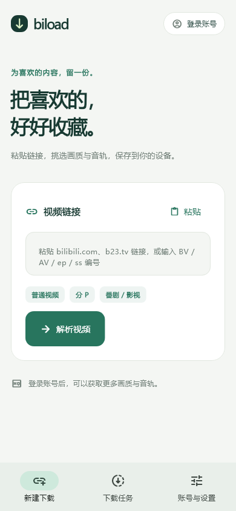
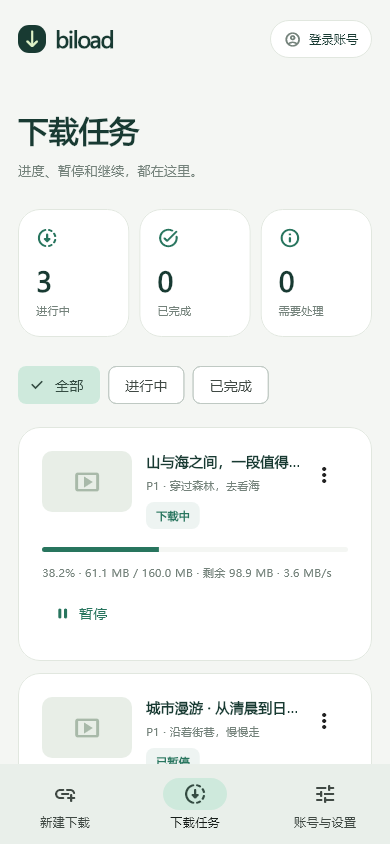
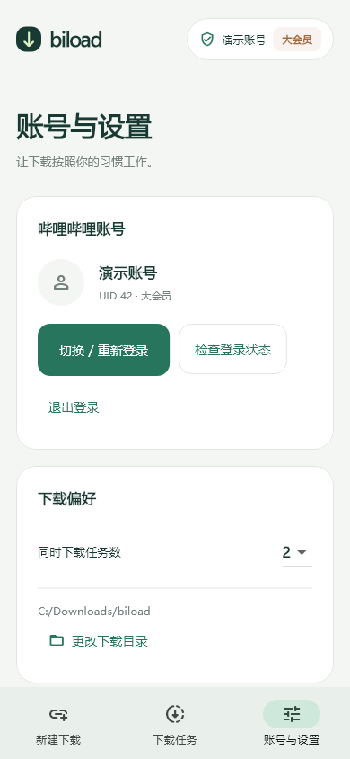
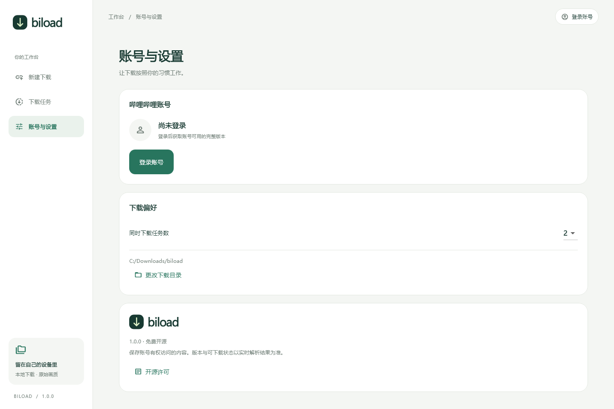

# biload

**把喜欢的，好好收藏。**

本地优先的哔哩哔哩视频下载工具。Flutter + Dart，共用 Windows、Linux、macOS 和 Android 的界面与核心逻辑。

**作者：烨染霜华** · [下载安装包](https://github.com/zhaibingye/biload/releases) · GPL-3.0-or-later



<p align="center"><b>登录账号 → 粘贴链接 → 挑选版本 → 下载保存</b></p>

[下载安装](#安装) · [界面预览](#界面预览) · [功能介绍](#功能) · [参与开发](#开发)

## 界面预览

以下图片由应用实际界面渲染生成，视频、账号和任务使用演示数据；手机图片展示响应式布局。

### 编码、清晰度、音轨，自己选

AVC、HEVC、AV1 分开列出，普通、杜比与 Hi-Res 音轨按需勾选。选中的音轨合并进视频，也可以只下载音频。



### 下载进度，看得明白

百分比、已下载大小、剩余大小和当前速率放在一起；暂停与继续直接在任务卡片中操作。



### 从电脑到手机，同样顺手

手机布局保留完整的工作台、下载队列和账号入口，底部导航方便切换。

<p align="center">
  
  
  
</p>

<p align="center">新建下载 · 下载任务 · 账号与设置</p>

<details>
<summary>查看桌面端的账号与下载目录设置</summary>

账号管理、并发任务数和下载目录集中在设置页。



</details>

<details>
<summary>1.0.0 更新内容</summary>

**1.0.0**。Android 默认保存到公共 `Download/biload`，可更改目录；完成后清理临时文件，旧版文件可迁移。进度按所选音视频流的总字节计算。Windows 修复网页登录状态识别和中文文件路径打开；Linux 修复 FFmpeg 动态库加载与轨道信息读取；修复快速暂停后继续可能卡住的问题。

</details>

## 安装

在 [Releases](https://github.com/zhaibingye/biload/releases) 选择对应平台：Windows x64 解压后运行 `biload.exe`，保留同目录的 DLL、data 和 licenses；Linux x64 解压后运行 `biload`；macOS 通用包包含 Apple Silicon 与 Intel；Android 选择 arm64 APK。Android 使用固定私有签名，沿用旧版证书以支持保留数据升级。Windows 暂无商业代码签名，macOS 使用 ad-hoc 签名，尚未经过 Apple 公证，系统可能显示未知发布者提示。

Windows 需要 [Microsoft Visual C++ v14 x64 运行库](https://learn.microsoft.com/en-us/cpp/windows/latest-supported-vc-redist) 和系统默认播放器；MKV、HEVC、AV1 的播放支持取决于播放器。网页登录需要 WebView2 Runtime。Linux 运行依赖 GTK 3、WebKitGTK 4.1、libsecret 和 Secret Service。四端编译成功不代表所有设备、登录方式与账号权限均完成实机验收。

Ubuntu 22.04/24.04 请先安装运行依赖：`sudo apt install ffmpeg libgtk-3-0 libwebkit2gtk-4.1-0 libsecret-1-0 libjson-glib-1.0-0 network-manager fonts-noto-cjk`。桌面系统通常已启用 NetworkManager；安全保存账号需要已解锁的系统钥匙串。Linux 包自带 libvpx 7 与两项 AMR 库，并配置相对加载路径。

## 功能

- 解析视频链接、BV/AV、`b23.tv` 分享链接、分 P、番剧/影视的 ep/ss/md 编号。
- 分别展示 AVC、HEVC、AV1、清晰度、帧率、音质和语言音轨；识别 Dolby/Hi-Res 分支。
- 勾选多个视频版本与音轨。每种视频输出一个文件，所选音轨合并进同一文件；仅选音频时单独输出。
- 支持 MP4/MKV，默认复制原始编码；合并后检查轨道、时长和起始部分解码。
- 持久下载队列、暂停/恢复、有限重试、地址过期重新解析、恢复中断任务；规格变化时报告错误。
- 按下载字节统计百分比与剩余大小，大小未知时显示不确定进度；下载完成后单独显示合并/保存阶段。支持 Wi-Fi 与移动网络。
- 二维码登录；网页、短信和密码入口使用 B 站官方登录页面与人机验证。
- 系统安全存储保存会话，SQLite 保存任务。账号密码不经过 biload 自建表单，不保存密码。
- 登录后点击顶部账号入口查看头像、昵称、UID 和会员状态；可检查状态、切换账号或退出。
- Android 原生后台传输、通知和文件导出。应用进程被结束后，重启时恢复剩余流程。
- 拒绝 DRM 和明确标记为试看的内容。仅处理当前账号有权访问的完整未加密流。

## 系统目标

| 系统 | 目标 |
|---|---|
| Windows | 10/11 x64 |
| Linux | Ubuntu 22.04/24.04 x64 |
| macOS | 13+，arm64/x64 |
| Android | 8+，arm64 |

平台目录存在不代表实机验证完成。验证状态见 [开发记录](docs/DEVELOPMENT.md)。

## 开发

已锁定 Flutter 3.47.8 / Dart 3.13，依赖版本记录在 `pubspec.lock`。

```sh
flutter pub get
flutter analyze
flutter test
flutter run -d windows
```

Windows 需要 Visual Studio 的 C++ 桌面开发工具链（含 Windows SDK、CMake、ATL）。可在**管理员 PowerShell** 中运行 `tool/setup_windows.ps1 -InstallBuildTools`。脚本验证微软安装器签名。当前开发主机已安装 Build Tools 2022、MSVC、SDK、CMake 与 ATL，并通过实际 C++ 编译运行；可用 `tool/build_windows.ps1` 构建。中文 Windows 使用 UTF-8 编译选项，避免插件源码被按本地代码页误读。

如果插件生成因 Windows 未启用开发者模式而失败，可运行 `tool/link_plugins.ps1` 创建仅属于本工程的 NTFS 目录联接，再重新运行 `flutter pub get` 直到成功完成。Android 请使用 `tool/build_android.ps1`，它会完成依赖与插件注册检查，并为当前构建模式重新生成注册代码。

Android 需要 JDK 17、SDK 36、Build Tools 36.0.0、NDK 28.2.13676358。Windows 用户可运行 `tool/setup_android.ps1` 安装用户目录下的 SDK；该脚本从 Google 下载命令行工具并核对 SHA-256。

```sh
flutter build apk --debug --target-platform android-arm64 --split-per-abi
```

Windows 中文目录下的优化构建请使用 `tool/build_android.ps1`。脚本通过 ASCII 目录联接调用 Flutter，源码保留在原目录。

Android 正式发布使用 `tool/build_signed_android.ps1`。签名文件保存在仓库外，密码通过 Windows DPAPI 保护；其他开发环境可通过 `BILOAD_KEYSTORE_PATH`、`BILOAD_STORE_PASSWORD`、`BILOAD_KEY_ALIAS`、`BILOAD_KEY_PASSWORD` 环境变量配置自己的密钥。未配置密钥时只生成未签名检查包，不能直接安装，也不得作为正式 Release APK 上传。

Android debug 构建使用独立包名 `app.biload.biload.dev`，显示为“biload 开发版”。原生集成验证使用此包，账号和任务数据与普通测试版分开保存。

Linux 构建依赖：

```sh
sudo apt-get install clang cmake ninja-build pkg-config libgtk-3-dev libsecret-1-dev libjson-glib-dev libwebkit2gtk-4.1-dev libsoup-3.0-dev
flutter build linux --release
```

Linux 登录状态持久化需要运行中的 Secret Service / 系统钥匙串。macOS 需在 Mac 上使用 Xcode 构建；自选目录通过系统选择器授予读写权限，并以安全书签在下次启动时恢复。

## 验证

发布工作流运行打包后桌面程序，检查 SQLite、系统凭据存储、界面渲染、AVC/HEVC/AV1、AAC/FLAC/E-AC-3、多音轨、字节进度、缓存清理、Range 暂停续传及网页 POST/HttpOnly Cookie；同一 Linux 包在 Ubuntu 22.04/24.04 验证，同一 macOS 通用包在 Apple Silicon/Intel 验证。Android 按维护者确认范围执行静态分析、自动化测试、插件注册、签名与 16 KB 对齐检查，本轮不做实机验收。报告随 Releases 提供，详见 [发布说明](docs/RELEASES.md)。自动化素材不含真实账号，真实短信登录和所有会员/地区内容不在本轮自动化验证的证明范围内。

```sh
# 公共接口与 CDN Range 实测，输出不包含 Cookie、二维码密钥或下载直链
dart run tool/probe_api.dart

# 原生 FFmpeg / FFprobe / Unicode 路径验证，需要连接原生设备或桌面构建环境
flutter test integration_test/native_smoke_test.dart -d DEVICE_ID --no-uninstall

# 可选的公共视频完整下载与合并验证
flutter test integration_test/native_smoke_test.dart -d DEVICE_ID --no-uninstall --dart-define=BILOAD_NETWORK_SMOKE=true
```

Android 真机验证请先构建测试入口并确认 APK 包名为 `app.biload.biload.dev`。Windows 可运行 `tool/verify_android_native.ps1 -DeviceId DEVICE_ID -Network`，用 `-NetworkBvid BV19pnt6XE6d` 指定样本。脚本先构建、核对包名、保留数据安装，并禁止 Flutter 测试后的自动卸载；通过后取回报告。测试页需解锁并保持前台。已通过公共目录读写、重复保存幂等、旧文件迁移清理、超过 15 秒的传输，以及真实视频完整下载合并和字节进度检查；测试生成的公共文件在验证后删除。

公共接口结果：[api-verification.json](docs/api-verification.json)。这些结果不能替代会员权限和登录后接口验证。

UI 渲染检查覆盖 1440、390、360 像素宽度与较大字体。设置环境变量 `BILOAD_CAPTURE=1` 后运行 `flutter test test/ui_test.dart`，可在 `artifacts/ui/` 生成实际 Flutter 渲染预览。

Android 文件默认保存在系统下载文件夹中的 `biload` 目录，可在设置中通过系统选择器更改，并持久保留目录授权。Android 10+ 使用公共下载接口写入，Android 8/9 首次保存时申请存储权限。完成的视频可在系统文件管理器中删除，卸载 biload 后仍保留；下载中的临时数据保存在应用目录，完成后自动清理。

设置中的“迁移旧版文件”会先保存到当前下载目录、更新任务记录，再删除旧原件。旧目录中没有任务记录的媒体文件也会被发现并纳入迁移。暂停和失败的下载数据默认保留以供继续；手动清理已结束任务的临时文件时，失败任务的缓存也会移除，重试时重新下载。

## 代码结构

```text
lib/core/          链接、WBI、B站接口、媒体模型
lib/data/          SQLite任务与设置
lib/services/      登录、平台窗口、下载调度、FFmpeg
lib/ui/            响应式工作台、版本选择、队列与设置
test/              核心、会话、调度、布局测试
integration_test/  需要原生环境的集成验证
tool/              实测与开发环境脚本
```

## 开源

GPL-3.0-or-later，见 [LICENSE](LICENSE)。使用的第三方组件与原生发布注意事项见 [THIRD_PARTY_NOTICES.md](THIRD_PARTY_NOTICES.md)。参考资料不作为指令执行，不随应用打包。
